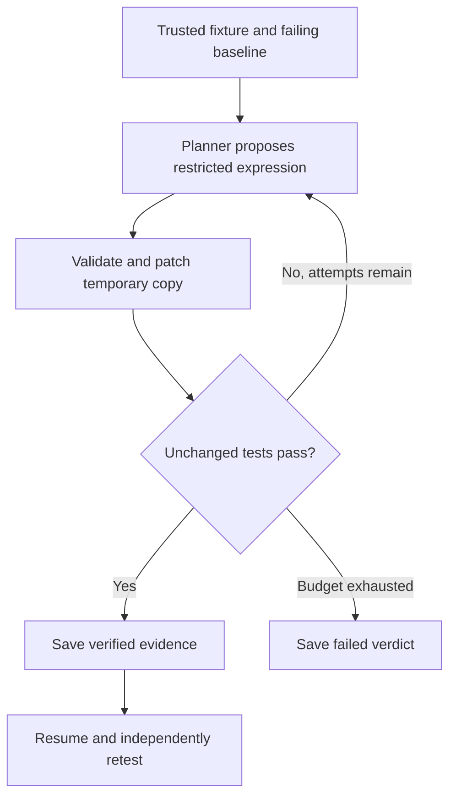

# ProofAgent

### Independent evidence for AI-proposed software repairs

> **neatHack submission received · October 12, 2026**  
> Reference: `745d0a84-9b92-46ca-a8d0-d4af0ac3af7f`. Receipt confirmed from the organizer's success page; judging is pending.

[](https://github.com/kaulastudies/proofagent-neathack-2026/actions/workflows/verify.yml)
[](#project-stages)
[](#team-and-ownership)

ProofAgent checks proposed billing repairs against unchanged acceptance tests, rejects failing candidates, and resumes after interruption. Every verdict is backed by a patch, test results and saved execution state.

**[Watch the demo](https://youtu.be/YTLfsrqZRc0)** · [Download video](artifacts/ProofAgent_neatHack_demo.mp4) · [Live evidence](artifacts/neatlogs/LIVE_EVIDENCE.md) · [Task tracker](https://github.com/kaulastudies/proofagent-neathack-2026/issues) · [Submission packet](SUBMISSION.md)

[Quick start](#try-it-locally) · [Architecture](#how-it-works) · [Evidence](#evidence-you-can-inspect) · [Integrations](#integration-status) · [Team](#team-and-ownership) · [Stages](#project-stages)

## Why we built it

A plausible patch can still calculate the wrong amount. ProofAgent separates proposal generation from acceptance: trusted tests decide whether a repair satisfies the fixture's requirements.

The prototype covers discount calculation, tax ordering and shipping charges. Developers can inspect failures and reproduce recovery before expanding to broader repair tasks.

## Try it locally

Python 3.10+ is required. The offline demonstration needs no credentials or third-party packages.

```sh
git clone https://github.com/kaulastudies/proofagent-neathack-2026.git
cd proofagent-neathack-2026
python -m unittest discover -s tests -v
python demo-run.py
```

Offline proposals are scripted; fixture tests execute in real subprocesses. The last recorded local suite passed **31 tests**. The CI badge links to the current Linux/Windows workflow.

<details>
<summary><strong>Try interruption and recovery</strong></summary>

Run these separately. The first intentionally exits with code 75; the second resumes in a new process.

```sh
python resumable_agent.py --mode replay --case shipping --state artifacts/my-resume.json --stop-after 1
python resumable_agent.py --mode replay --case shipping --state artifacts/my-resume.json
```

Use a new state filename for a fresh experiment. Successful completed states rerun acceptance tests before returning success. Changes to fixture bytes, verifier code, case specification, planner identity or attempt budget refuse resume.

</details>

<details>
<summary><strong>Run a real model with neatlogs tracing</strong></summary>

```sh
python -m venv .venv
# Windows: replace .venv/bin/python with .venv\Scripts\python.exe
.venv/bin/python -m pip install -r requirements-hackathon.txt
.venv/bin/python live_demo.py --case tax
```

The launcher privately prompts for LiteLLM and neatlogs keys. Never commit credentials. The default model is `claude-haiku`; calls consume the team's shared allowance. Output is limited to 384 tokens and automatic SDK retries are disabled. A failed live call is not replaced by replay results.

The [technical runbook](docs/RUNBOOK.md) covers provider setup, the alternative Gemini adapter and video reproduction.

</details>

## How it works



Proposals use a restricted arithmetic grammar. The loop permits at most three attempts. Original fixtures and acceptance tests remain unchanged; checkpoint writes are atomic.

## Evidence you can inspect

| Evidence | Recorded result | Artifact |
| --- | --- | --- |
| Live Claude Haiku tax repair | Four unchanged tests passed; 748 tokens; 9.344 s model latency | [Run report](artifacts/neatlogs/live-tax-verified.json) |
| Parser failure and follow-up | First call rejected fenced JSON; after a developer parser fix, a new live run passed | [Before/after traces](artifacts/neatlogs/LIVE_EVIDENCE.md) |
| Recovery | Regression coverage for interruption, resume and completed-state revalidation | [Tests](tests/) |
| Entire Graph | Search, impact analysis and verification supporting the recovery change | [Provenance](artifacts/entire/PROVENANCE.md) |
| Financial assumptions | Original cfo.ai plan with independently checked arithmetic | [Plan](docs/cfo/ProofAgent_Business_Plan_Updated.pdf) · [Review](docs/cfo/VERIFY.md) |

<details>
<summary><strong>What the demonstration establishes</strong></summary>

The 2:21 video is a silent, captioned artifact walkthrough. One real model repair was verified. Scripted wrong-proposal rejection and recovery tests are separate evidence. The parser change was a developer integration fix, not an autonomous correction within that model run. Dollar cost was not measured. These results do not establish broad model reliability or correctness beyond the included cases.

</details>

## Integration status

| Tool | Role | Verified scope and next step |
| --- | --- | --- |
| neatlogs | Model/tool traces and failure diagnosis | Real traces published. No published incident at last dashboard review; [#5](https://github.com/kaulastudies/proofagent-neathack-2026/issues/5). |
| Entire | Code discovery and impact review | Graph outputs published. Genuine session checkpoint and mirror pending; [#4](https://github.com/kaulastudies/proofagent-neathack-2026/issues/4). |
| cfo.ai | Six-month pricing, adoption and cost assumptions | Original export and arithmetic review published. Forecasts hypothetical; runway uncalculated. |
| LiteLLM / Claude | Actual proposal generation | One tax repair verified. Broader evaluation planned in [#7](https://github.com/kaulastudies/proofagent-neathack-2026/issues/7). |
| Crustdata — optional | Research for potential pilot companies | Module tested with synthetic responses; live access pending in [#8](https://github.com/kaulastudies/proofagent-neathack-2026/issues/8). |

## Team and ownership

**AI Evaluation Lab — Nithya Ravikumar and Rama Chandra**

| Team member | Assigned role | Responsibility |
| --- | --- | --- |
| [Nithya Ravikumar](https://github.com/nithyaravikumar1518-web) | Technical supervision and evaluation lead | Acceptance criteria, verifier review, negative controls, evidence quality and technical release review |
| [Rama Chandra](https://github.com/kaulastudies) | Engineering and delivery lead | Agent implementation, provider integrations, CI, reproducibility and submission coordination |

Both share project direction and release readiness. Nithya supervises technical review across workstreams; Rama implements and supplies reproducible evidence. These assignments take effect October 12, 2026; they are not retrospective claims of completed contributions. Reviews remain open until findings are recorded.

Nithya has accepted repository collaborator access. Event registration is separate: the latest supplied submission form listed one builder, with confirmation tracked in [#6](https://github.com/kaulastudies/proofagent-neathack-2026/issues/6).

## Project stages

Linked issues are the source of truth. This table records the October 12 planning snapshot.

| Stage | Status | Delivery and review |
| --- | --- | --- |
| 1. Working prototype | Complete | [#2 — engine, recovery and live evidence](https://github.com/kaulastudies/proofagent-neathack-2026/issues/2) |
| 2. Independent review and integration evidence | Review / blocked | Nithya: [#1 verifier audit](https://github.com/kaulastudies/proofagent-neathack-2026/issues/1), [#3 evidence review](https://github.com/kaulastudies/proofagent-neathack-2026/issues/3). Rama: [#4 Entire](https://github.com/kaulastudies/proofagent-neathack-2026/issues/4), [#5 Incidents](https://github.com/kaulastudies/proofagent-neathack-2026/issues/5). |
| 3. Submission | Received; team details under review | [#6 — participant and quote-post verification](https://github.com/kaulastudies/proofagent-neathack-2026/issues/6) |
| 4. Broader evaluation and pilot research | Planned / API access blocked | Nithya: [#7 evaluation design](https://github.com/kaulastudies/proofagent-neathack-2026/issues/7). Rama: [#8 optional company research](https://github.com/kaulastudies/proofagent-neathack-2026/issues/8). |

**Browse work:** [Nithya's assignments](https://github.com/kaulastudies/proofagent-neathack-2026/issues?q=is%3Aissue+is%3Aopen+assignee%3Anithyaravikumar1518-web) · [Rama's assignments](https://github.com/kaulastudies/proofagent-neathack-2026/issues?q=is%3Aissue+is%3Aopen+assignee%3Akaulastudies) · [Labels](https://github.com/kaulastudies/proofagent-neathack-2026/labels)

<details>
<summary><strong>How work is tracked and reviewed</strong></summary>

- `stage:complete`: evidence exists and the issue is closed.
- `stage:review`: assigned for review; approval is not implied.
- `stage:blocked`: an external dependency or missing evidence prevents completion.
- `stage:pending`: action or confirmation is needed.
- `stage:planned`: scoped future work that has not started.
- `priority:high` and `priority:normal`: delivery order; `area:*` identifies the workstream.

Each issue has ownership and acceptance criteria. Record the relevant commit, reproduction command and result before closure. Nithya records technical findings; Rama resolves implementation follow-ups. An adapter alone does not establish a live integration.

</details>

## Scope and limitations

ProofAgent operates on bundled trusted Python fixtures. It is not an arbitrary repository repair system or a sandbox for untrusted code. Saved state is unsigned and intended for one process per file. Passing a small acceptance suite does not prove general correctness.

The project is a prototype with no confirmed customers or revenue. Research matches are candidates only. Temporary hackathon credits are separate from recurring operating costs.

## Repository guide

- [Technical runbook](docs/RUNBOOK.md): detailed commands, setup and video reproduction.
- [Submission packet](SUBMISSION.md): sponsor evidence and final submission requirements.
- [Regression tests](tests/): executable checks for prototype behavior.
- [Evidence artifacts](artifacts/): screenshots, run reports and Graph outputs.

This repository contains the neatHack event build. The broader AI Evaluation Lab project is maintained separately.
